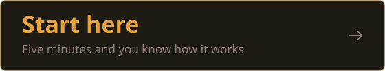
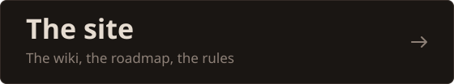
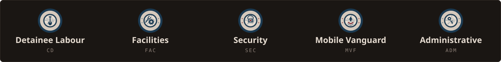
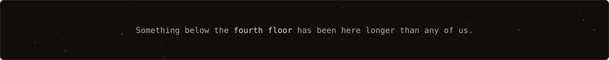

### The headline is literal

On day one there's a supply pier, a prison camp and a hole in the side of a mountain. Everything else gets dug out of the ground and built by the people playing.

**Prisoners dig.** They work the rock face and haul what they break out to the skip. Every stud of this place starts as somebody swinging a tool.

**Facilities build what gets dug.** Engineering put actual buildings on the live map. Logistics drive the truck, work the docks and keep the stores full.

**Nothing resets.** A bar fills as everybody digs, and when it fills, a whole new part of the site opens up for everyone, for good. Floor 2 doesn't exist until somebody digs it out.

### Five departments

Go with whatever you'd actually enjoy doing on a Tuesday night rather than whatever sounds most important. Nobody is stuck where they start.

| Department | What a shift looks like |
|---|---|
| **Detainee Labour** | The prisoners. No application, no interview. You could be digging in about a minute. |
| **Facilities** | Put buildings on the map that stay there, and run the supply line that feeds them. |
| **Security** | The guards. Gates, escorts, head counts, and the riot when it kicks off. |
| **Mobile Vanguard** | Most nights you do nothing at all. Then the alarm goes. Ten seats, selection only. |
| **Administrative** | The office. Sign people in, keep the records, write up whatever went wrong. |

Ranks are six steps and they're the same six everywhere, so a Foreman in Facilities and a Sergeant in Security are the same level and nobody has to argue about who's in charge. Starting as a prisoner doesn't leave you stuck either: three clean shifts gets you Trusty, and serving your time lets you walk into any department you like.

### What comes next

No dates, just what waits on what. [The roadmap](https://prcblacksite.github.io/roadmap/) shows what's live, what's being built and what each thing is waiting on.

### Where things stand

Discord is open now. The doors open on **Saturday 31 October 2026**, and everybody who joins before then keeps a Founder rank that never gets handed out again.

<a href="https://www.tiktok.com/@prcblacksite">TikTok</a> · <a href="https://www.youtube.com/@prcblacksite">YouTube</a> · <a href="https://x.com/prcblacksite">X</a> · <a href="https://www.instagram.com/prcblacksite/">Instagram</a> · <a href="https://www.reddit.com/r/PRCBlacksite/">Reddit</a>

&copy; 2026 Prometheus Research Corporation. All rights reserved. The text, artwork and pages here are not licensed for reuse.

